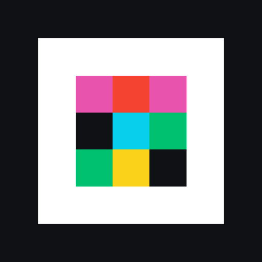

  <picture>
    <source media="(prefers-color-scheme: dark)" srcset="Docs/mark-dark.png">
    
  </picture>

# Mainstream

An iOS app that sends text, photos and videos (from the library or taken in the app), audio recordings, contacts, Wi-Fi networks, your location and any file between phones as an animated colour code: one phone shows it, the other reads it with its camera. In simulation it moves ~0.4–1.9 MB/s, depending on focus and distance. It also appears in other apps' share sheets.

## Build
Open `Mainstream.xcodeproj` in Xcode 27.1, or run `xcodegen generate` after editing `project.yml`. Choose your signing team and run on two devices. The Run scheme uses Release because the decoder needs optimisation to keep up.

## Using it
- **Camera controls (right edge):**
  - Tap the preview to focus there; pinch to zoom, or tap the zoom button (1× → 2× → 4×).
  - The slider sets the lens position manually (top = far). On phones whose ultra-wide camera focuses closer, the slider continues below the main camera's closest focus by switching to it (macro), cropped to match the main camera's view.
  - The viewfinder button returns to continuous autofocus.
  - The camera-pair button (on phones that support it) runs the wide and ultra-wide cameras together. If the pair fails or the phone gets too hot, the app carries on with one camera and turns the button off.
- **Payload bar:** text (with paste), photo or video library, take a photo, record audio, file; the … button shows contact, Wi-Fi network and current location.
- **Share sheet:** choose Mainstream in any app's share sheet to show the shared item as the code right there.
- **Sender:** sliders for density and frame rate. The top bar shows the payload's size; for photos and videos a button switches between the smaller re-encoded version (the default) and the original.
- **Received items** open with the action that fits: links open, Wi-Fi networks can be joined, locations show on a map, contacts can be added, photos and videos saved, phone numbers, links and addresses in text become buttons, and other files open in Quick Look.
- The top-right gauge always shows how much has arrived and the live rate. A chevron says when the sender has spare error-correction margin (↑, try denser or faster) or too much loss (↓).

## How it works (`Core`, module `MainstreamCore`)
| Layer | Choice |
|---|---|
| Fountain | Systematic random linear code over GF(2). Blocks hold ≤1024 symbols of 180 bytes, with online Gaussian elimination. It's rateless, so lost packets only cost time. Overhead ≈1–2%. |
| Compression | Payloads are compressed losslessly before sending when that saves at least 3%: LZMA up to 4 MB, LZFSE above (a trial on the first 256 kB skips media that won't shrink). The receiver expands to exactly the declared size, at most 1 GB. Photos can also be re-encoded as HEIC at up to 2560 px (location metadata dropped) and videos at 960×540. |
| Packet | 7-byte header, 180-byte payload, CRC-32, Reed–Solomon parity (32–64 bytes). Decoding handles errors and erasures, using the least-confident bytes as erasures. |
| Frame | 4 finders (3 are enough). A CRC-16 header works in any rotation. 5×5 alignment markers sit every ~24 cells, and each codeword covers a near-square patch. |
| Receiver | Per-cell local normalisation and blind colour-crosstalk inversion. A decision-feedback inter-cell equaliser roughly doubles goodput under defocus in simulation. Every stage runs in parallel, and each camera feeds a small pool of decoders, so dense frames (8–12 ms each on an M3) keep up with 60 fps instead of being dropped. |
| Camera | 60 fps at the highest resolution available (4K60 when single). Exposure is capped at 1/250 s, with −0.7 EV, near-range autofocus and stabilisation off. Multi-camera mode feeds both cameras, at up to 1440p each, into one transfer. That gives diversity (a second look and a different focus distance) rather than double the raw rate. Frame rates are halved under thermal pressure. |

The app icon and the logo in this README are drawn by `Tools/make-icon.swift` from the brand mark (instructions at the top of the file).

## Simulation and tests
`swift test -c release` in `Core` covers Reed–Solomon, the fountain code, compression, the layouts and the end-to-end camera link, plus fuzz tests that feed the decoders noise, badly framed codes, random packets and random codewords.

`swift run -c release MainstreamSim` sweeps the rate ladder through a synthetic camera. The camera model includes perspective, blur, moiré, crosstalk, noise and vignetting. Environment switches select other runs:

| Switch | Runs |
|---|---|
| `TEMPORAL=1` | Display scan-out and rolling shutter |
| `DECODE=shot.png` | Decodes a screenshot of the sender |
| `BENCH=1` | Render and decode time per level |

Findings that shaped the design: goodput climbs with density until Reed–Solomon failures dominate, then falls off a cliff. 60 fps frames beat 30 fps.
